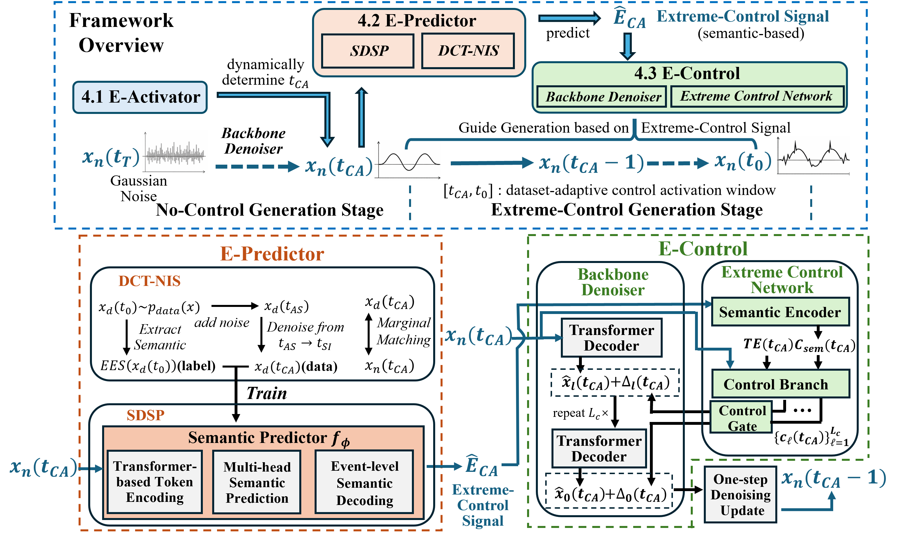

# E4GEN: Event-level Explainable Extreme-Enhanced Time-series Generation

Official implementation of the paper:

> **E4GEN: Event-level Explainable Extreme-Enhanced Time-series Generation**

<p align="center">
  
</p>

---

## 1. Environment Setup

From the repository root, where `requirements.txt` is located, create and activate the environment:

```bash
conda create -n E4GEN python=3.10 -y
conda activate E4GEN
pip install -U pip
pip install -r requirements.txt
```

---

## 2. Provided Results and Visualization

We provide the current experimental results directly in the following notebooks:

- `Final Result/Standard Metric.ipynb`
- `Final Result/Standard Visualization.ipynb`

---

## 3. Run DiffusionTS Backbone (Train + Sample)

From the repository root, run:

```bash
bash Bash/DiffusionTS/run_timeseries_full_pipeline.sh
```

Before execution, edit the **`NAME`** and **`CONFIG`** variables in the shell script.

| `NAME` | `CONFIG` |
|---|---|
| `toyexample_diffusionts` | `Config/Extreme/toyexample.yaml` |
| `power_diffusionts` | `Config/Extreme/power.yaml` |

For heavy-tailed diffusion noise, use `Bash/HeavyDiff/run_timeseries_full_pipeline.sh` with `--heavy`.

---

## 4. Analyze and Visualize Generated Results

After running the full generation pipeline, use the following notebook to analyze and visualize the generated results:

```text
result_analysis_visualization.ipynb
```

---

## 5. Baselines

Baseline implementations and execution scripts are organized as follows:

- **HeavyDiff**: see `Bash/HeavyDiff/`
- **Diffusion-TS**: see `Bash/DiffusionTS/`
- **Other baselines**: see `Baseline/`

---