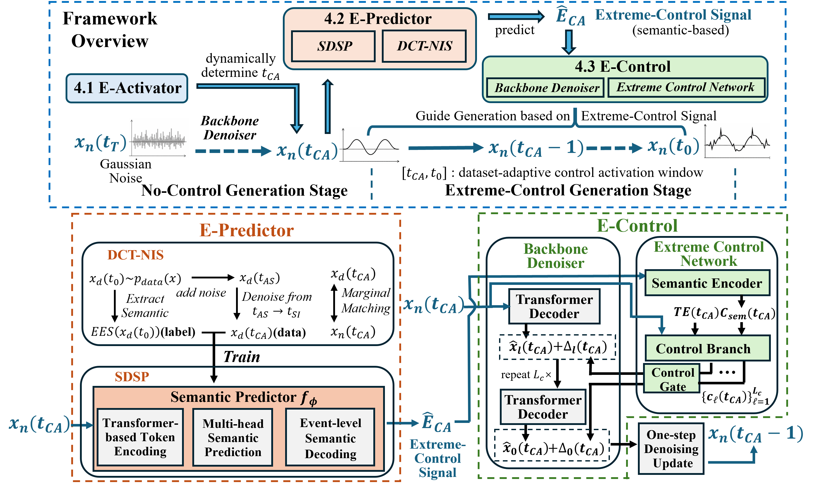
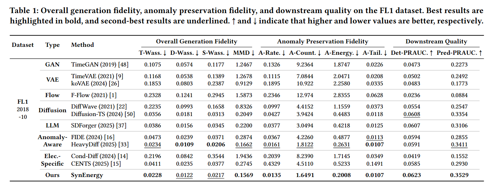

# SynEnergy: Anomaly Semantic-Guided Diffusion for Synthetic Energy Data Generation

Official implementation of **SynEnergy**, a two-stage diffusion framework for **anomaly-preserving synthetic energy data generation**.

- **HG-ASL** learns region-specific anomaly semantics from residual consumption patterns and cross-region dependencies.
- **AS-Diff** injects the learned anomaly semantics into a diffusion Backbone Denoiser through **AS-Control**.

## Framework



## Results



| Stage | Components | Role |
|---|---|---|
| **HG-ASL** | SR-Encoder, AS-Pooling, RAPA-Graph | Learns region-specific anomaly semantics |
| **AS-Diff** | Backbone Denoiser, AS-Control | Generates anomaly-preserving synthetic consumption data |

**Configuration:** `SynEnergy/Config/Extreme/power_FL.yaml`

**Bundled data:** `SynEnergy/Data/Power/Tallahassee_seq_180_sample_10000.npy`

---

## Setup

```bash
cd SynEnergy
pip install -U pip
pip install -r requirements.txt
```

Python 3.10 or later is recommended. A CUDA-enabled GPU is recommended.

---

## Quick Start

From the repository root:

```bash
bash Bash/run_power_FL1.sh
```

The script runs:

1. Backbone Denoiser training
2. HG-ASL and AS-Control training
3. Synthetic data generation

---

## Manual Commands

Run the following commands from `SynEnergy/`:

```bash
cd SynEnergy

CONFIG=Config/Extreme/power_FL.yaml
NAME=power_FL1
```

### Step 1: Train the Backbone Denoiser

```bash
python main.py \
  --name "${NAME}" \
  --config_file "${CONFIG}" \
  --train \
  --heavy \
  --condition
```

### Step 2: Train HG-ASL and AS-Control

```bash
python main.py \
  --name "${NAME}" \
  --config_file "${CONFIG}" \
  --train \
  --heavy \
  --controlnet \
  --condition
```

### Step 3: Generate Synthetic Data

```bash
python main.py \
  --name "${NAME}" \
  --config_file "${CONFIG}" \
  --sample \
  --heavy \
  --controlnet \
  --condition
```

Optional arguments:

```text
--seed 42
--sample_seed 42
```

---

## Outputs

Main artifacts are written to `SynEnergy/OUTPUT/power_FL1/`. Below are the **key output files** (not an exhaustive list):

| File | Description |
|------|-------------|
| `origin_data_norm_power_FL1.npy` | Original training sequences (MinMax-normalized) |
| `origin_data_unnorm_power_FL1.npy` | Original training sequences (denormalized, physical scale) |
| `generate_data_norm_power_FL1.npy` | Generated synthetic sequences (MinMax-normalized) |
| `generate_data_unnorm_power_FL1.npy` | Generated synthetic sequences (denormalized, physical scale) |

---

## Evaluation

Evaluation scripts are provided in:

```text
SynEnergy/Experiment/Result_Analysis/Metric_Check.ipynb
```

Set:

```python
RUN_NAME = "power_FL1"
```

The evaluation includes:

- **Overall Generation Fidelity:** T-Wass., D-Wass., S-Wass., MMD
- **Anomaly Preservation Fidelity:** A-Rate, A-Count, A-Energy, A-Tail
- **Downstream Quality:** Det-PRAUC, Pred-PRAUC

---

## Repository Layout

```text
SynEnergy/
├── main.py
├── Config/
│   └── Extreme/
│       └── power_FL.yaml
├── Data/
│   └── Power/
├── controlnet/
├── Models/
├── Figures/
│   ├── Framework.png
│   └── Table.png
├── Bash/
│   └── run_power_FL1.sh
└── Experiment/
    └── Result_Analysis/
        └── Metric_Check.ipynb
```

## Baselines

We compare SynEnergy with 11 baseline methods across seven categories.

| Baseline | Category | Venue | GitHub |
|---|---|---|---|
| TimeGAN | GAN | NeurIPS 2019 | https://github.com/AlexanderVNikitin/tsgm/blob/main/tsgm/models/timeGAN.py |
| TimeVAE | VAE | arXiv 2021 | https://github.com/wangyz1999/timeVAE-pytorch |
| koVAE | VAE | ICLR 2024 | https://github.com/azencot-group/KoVAE |
| F-Flow | Flow | ICLR 2021 | https://github.com/ahmedmalaa/Fourier-flows |
| DiffWave | Diffusion | ICLR 2021 | https://github.com/lmnt-com/diffwave |
| Diffusion-TS | Diffusion | ICLR 2024 | https://github.com/Y-debug-sys/Diffusion-TS |
| SDForger | LLM | NeurIPS 2025 | https://github.com/IBM/fms-dgt/tree/main/fms_dgt/public/databuilders/time_series |
| FIDE | Extreme-Aware | NeurIPS 2024 | https://github.com/galib19/FIDE |
| HeavyDiff | Extreme-Aware | ICLR 2025 | https://github.com/Y-debug-sys/Diffusion-TS |
| CENTS | Electricity-Specific | arXiv 2025 | https://github.com/DAI-Lab/Cents |
| Cond-Diff | Electricity-Specific | Energy and Buildings 2024 | https://github.com/buds-lab/energy-diffusion |

## Citation

Citation information will be added after publication.